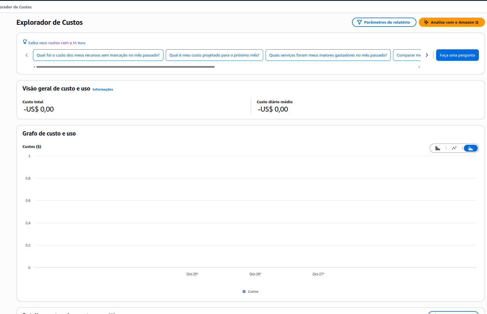
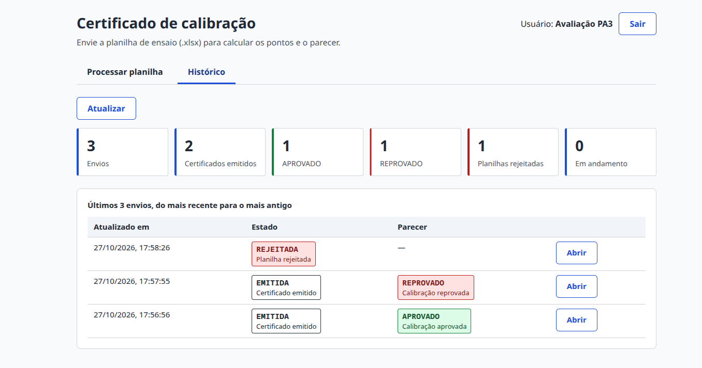
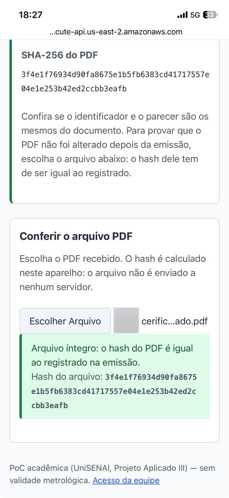

# AV04 — Plataforma Web de Gestão e deploy em nuvem

<!-- Cada tarefa acrescenta o seu trecho na seção indicada em "Relatório" no guia.
     PDF: cd ferramentas/relatorio && npm ci && node gerar-relatorio.mjs. -->

**Relatório Técnico Integrado** · Automação da emissão de certificados de calibração (Schulz S.A.)

| | |
| --- | --- |
| **Unidade Curricular** | Projeto Aplicado III — UniSENAI/SC |
| **Docente** | Prof. MSc. Hugo Menezes Barra |
| **Empresa parceira** | Schulz S.A. — Schulz Metrologia (Setor Dimensional), Joinville/SC |
| **Grupo 39** | Adrian David Castillo Marcano — RA `<preencher>`; Nícolas Kretzschmar Lange — RA `<preencher>`; Rodrigo Mainardes Ribeiro — RA `<preencher>` |
| **Entrega** | AV04 — Plataforma Web de Gestão e deploy na AWS (Camada Gratuita) |
| **Repositório GitHub** | <https://github.com/NicolasKLange/projeto-aplicado-iii> |
| **Plataforma em nuvem** | <https://n0jdkil21h.execute-api.us-east-2.amazonaws.com/> (stack `pa3-av04`, `us-east-2`) |
| **Vídeo (YouTube)** | `<preencher: link do vídeo não listado>` |

## 1. Introdução e vínculo com AV01–AV03

A Schulz Metrologia leva cerca de 13 dias entre medir um dispositivo na máquina de medição por
coordenadas (MMC) e emitir o certificado de calibração. O caminho é uma cadeia de planilhas Excel
acopladas por cópia manual, com 28 valores transportados à mão por certificado, cálculo não validado e
nenhuma trilha de auditoria. Esse foi o diagnóstico da **AV01**, que levantou os requisitos (RF, RNF),
as regras de negócio (RN) e as anomalias (AN) usados como referência em todo este relatório.

A **AV02** projetou uma arquitetura *serverless* de custo zero na AWS: o upload da planilha no storage
dispara a função que lê o arquivo, grava no banco e gera o PDF; a autoria vem da autenticação do usuário,
sem ICP-Brasil; os registros têm retenção de 5 anos por regras de ciclo de vida. A **AV03** construiu o
motor transacional: leitura e validação da planilha contra um contrato de 15 regras (R01–R15) e o cálculo
de média, erro sistemático, status por ponto e parecer, em `BigDecimal`, num núcleo Java independente de
framework.

A **AV04** integra as três etapas numa **Plataforma Web de Gestão** publicada na AWS, dentro da Camada
Gratuita. O mesmo núcleo da AV03 roda dentro de uma função Lambda; o pipeline da AV02 está implantado
de ponta a ponta (upload → evento → cálculo → DynamoDB → PDF → verificação pública por QR Code); e a
interface web permite ao engenheiro entrar com o seu usuário, processar planilhas, acompanhar o resultado,
baixar o certificado e consultar o histórico com indicadores. Qualquer pessoa que receba o certificado
confere a autenticidade pelo celular, lendo o QR Code impresso, sem login. O recorte da entrega e as
divergências em relação à AV02 estão declarados na D-018 (§2) e na §11.

## 2. Decisões da entrega

As decisões D-015 a D-020 (`docs/decisoes.md`, 24/10/2026) fecham o escopo da AV04 antes do código:

- **D-015, Plataforma Web:** o público é o engenheiro no laboratório; a validação por QR Code do roteiro é uma página pública responsiva aberta pela câmera do celular (RF-16 da AV01).
- **D-016, SPA em S3 privado + CloudFront com OAC:** HTTPS para a tela de login; o plano gratuito oferece 1 milhão de requisições e 100 GB/mês, sem cobrança de excedente (https://aws.amazon.com/cloudfront/pricing/, 24/10/2026). Descartados: Amplify Hosting e S3 com website público.
- **D-017, Maven multimódulo (`nucleo`, `app-local`, `funcoes`):** o `nucleo` não declara o Spring, então o compilador garante a D-012; as funções Lambda levam só o núcleo e o SDK da AWS.
- **D-018, recorte:** passos 1–7 e 10 do fluxo da AV02; ficam no roadmap TOTP, aprovação/RN-12, numeração com Object Lock e incerteza (R-46 a R-50). Mudanças técnicas: PUT pré-assinado no lugar do POST e rejeição registrada no DynamoDB no lugar de `quarentena/`.
- **D-019, bibliotecas:** SDK da AWS v2, eventos do Lambda, PDFBox 3, ZXing `core`, React + Vite e SAM CLI.
- **D-020, runtime `java21` com bytecode 17:** o `java17` (AL2) vai até 30/06/2027; `java21` (AL2023) até 30/06/2029 (https://docs.aws.amazon.com/lambda/latest/dg/lambda-runtimes.html, 24/10/2026).

As decisões seguintes nasceram durante a implementação:

- **D-021, persistência e idempotência:** tabela única com sentinelas `HASH#` e `TOKEN#` gravadas na mesma transação do estado (§4).
- **D-022, região `us-east-2`:** a SCP do plano gratuito da "nova experiência AWS" só libera serviços regionais nessa região; efeito de LGPD tratado na §7.
- **D-023, ingestão em memória e números como texto:** o objeto de até 5 MB é lido inteiro; valores metrológicos são gravados como texto para preservar a escala 10.
- **D-024 e D-025, `fn-certificado` e `fn-api`:** o nome de exibição do "Gerado por" é lido do Cognito no momento da emissão e não é gravado em tabela, evento nem log.
- **D-026, CloudFront fora do template:** o plano gratuito do CloudFront exige um WAF em `us-east-1`, região negada pela SCP.
- **D-027, interface servida pelo próprio HTTP API:** a `fn-web` (Node.js 22) lê a SPA do bucket privado e a entrega nas rotas `GET /` e `GET /{proxy+}`, com HTTPS do API Gateway, na mesma origem da API e sem CloudFront. Substitui a D-016 (§3 e §6).

## 3. Arquitetura implementada

```
 Navegador (React) ── HTTPS ──► API Gateway HTTP API (us-east-2, autorizador JWT do Cognito)
   │                               ├─ GET / e GET /{proxy+} ─► fn-web ──► S3 web (privado): a SPA
   │ 1. login (InitiateAuth) ──► Cognito
   │ 2. POST /uploads (JWT) ───────┼─► fn-api ──► URL PUT pré-assinada (5 min, 5 MB)
   │ 3. PUT da planilha ─────────► S3 entrada  uploads/<sub>/<id>.xlsx
   │                                   │ 4. s3:ObjectCreated (assíncrono)
   │                                   ▼
   │                              fn-ingestao ── núcleo AV03 ──► DynamoDB (HASH# na mesma transação)
   │                                   │ 6. destino de sucesso            falha ──► SQS (fila de falhas)
   │                                   ▼
   │                              fn-certificado ── PDFBox + QR ──► S3 certificados/<id>.pdf; TOKEN#
   │ 10. GET /calibracoes, /calibracoes/{id}, /pdf (JWT)   ·   GET /verificacao/{token} (público)
```

**Interface servida pela `fn-web` (D-027).** O CloudFront previsto na D-016 não pôde ser usado: o plano
gratuito dele exige um WAF em `us-east-1`, e a SCP da conta só libera `us-east-2` (D-026). A interface
passou a ser servida pelo próprio HTTP API. A SPA compilada pelo Vite fica no bucket `web`, privado, e uma
quinta função, `fn-web` (Node.js 22, 256 MB, cerca de 100 linhas em `infra/fn-web/index.mjs`, sem
dependências empacotadas, porque o SDK v3 já vem no runtime), atende às rotas `GET /` e `GET /{proxy+}`
sem autorizador. As rotas da API, mais específicas, têm precedência sobre o `{proxy+}`. Caminho sem
extensão (`/`, `/verificar/<token>`) recebe o `index.html`, para a SPA decidir a tela; arquivo com
extensão é lido do bucket (404 se não existe); caminho com `..` é recusado. O `index.html` sai com
`Cache-Control: no-cache` e os assets, que têm hash no nome, com cache de um ano. Ganhos: HTTPS sem WAF,
a Lambda na cota permanente, interface e API na mesma origem (a API não precisa de CORS para a tela) e a
URL do QR Code conhecida no próprio stack. A função só tem `s3:GetObject` no bucket `web` e não registra o
caminho pedido, porque a rota de verificação carrega o token do certificado. Oito testes com `node:test`
cobrem rotas da SPA, cache, binário em base64, 404, 405, `%` malformado e a falha do S3 sem detalhe.

**Ciclo de dependências evitado.** O CORS dos buckets de entrada e de certificados passou a liberar a
origem da própria API (o navegador faz o `PUT` e o download direto no S3). Como o SAM gera a definição da
API com a integração da `fn-api`, a API depende da `fn-api`; se a `fn-api` continuasse a referenciar os
buckets com `!Ref`, haveria o ciclo `BucketEntrada → Api → FnApi → BucketEntrada`. A `fn-api` passou a
montar nome e ARN dos buckets pelo nome do stack, como a `fn-ingestao` já fazia. Um verificador de
dependências escrito para esta entrega confirmou o template sem ciclos (e detecta o ciclo quando o `!Ref`
volta).

**Estrutura de módulos (D-017).** O projeto é um Maven multimódulo: `nucleo` (cálculo metrológico e leitura da planilha, só com o Apache POI), `app-local` (tela e API da AV03, com Spring Boot) e `funcoes` (Lambdas, a partir da T05). O POM pai mantém o `spring-boot-starter-parent` para herdar a gestão de versões, mas só o `app-local` declara dependência do Spring. O cálculo de SHA-256 em streaming (`Medidor`) foi para o `nucleo`, porque a `fn-ingestao` também precisa dele; o log continua no `ProcessamentoService`.

**Prova da D-012.** O `pom.xml` do `nucleo` não tem Spring nem AWS, então um `import` de framework ali não compila; e `grep -r "springframework" nucleo/` devolve vazio. Os 71 testes da AV03 continuam passando (56 no `nucleo`, 15 no `app-local`), sem alteração de código de teste. As planilhas sintéticas ficam só no `nucleo` e o `app-local` as consome pelo *test-jar*, sem duplicar arquivos.

**`fn-ingestao` (T06).** O handler recebe o evento do S3, extrai `sub` e `uploadId` da chave `uploads/<sub>/<uploadId>.xlsx` e lê o objeto inteiro para memória (teto de 5 MB, D-023). Calcula o SHA-256, consulta o dono do hash e, se a planilha é nova, lê, calcula e grava pela porta `RepositorioCalibracoes`. Planilha inválida grava `REJEITADA` e duplicata grava `DUPLICADA`, ambas terminando com sucesso e sem `calibracaoId` no retorno, para que a `fn-certificado` não seja acionada; falha inesperada (chave fora do padrão, envio inexistente, S3 ou DynamoDB indisponível) lança exceção e o evento vai para a DLQ. O log traz só `uploadId`, SHA-256, tamanho e resultado, e um teste confirma que `sub` e chave não aparecem. O adaptador DynamoDB grava cada transição com sentinela em uma `TransactWriteItems` de dois itens, e uma função pura (`DecisorCancelamento`) separa evento repetido, duplicata e erro transitório a partir dos motivos do cancelamento. Valores metrológicos são gravados como texto para preservar a escala 10. Os 35 testes da `funcoes` usam S3 e DynamoDB falsos; a prova das condições no DynamoDB real fica para a T09.

**`fn-certificado` e `fn-api` (T07).** A `fn-certificado` recebe o envelope do destino OnSuccess e lê `responsePayload.calibracaoId`; envelope sem o campo (rejeitada ou duplicada) é ignorado com sucesso, e uma calibração já `EMITIDA` (reentrega) não gera PDF de novo. Em `PROCESSADA`, lê o nome de exibição no Cognito (`AdminGetUser` pelo `sub`, D-025) apenas para o "Gerado por" do PDF, sem gravá-lo em tabela, objeto, evento nem log, e sorteia o token de 32 caracteres com `SecureRandom`, gera o PDF, grava `certificados/<id>.pdf` com SSE-S3 e só então muda o estado para `EMITIDA` pela porta (transação com a sentinela `TOKEN#`); se a gravação no S3 falha, o estado não muda e o evento vai para a DLQ. A `fn-api` é um handler único com roteamento por `routeKey`: `POST /uploads` recusa mais de 5 MB (413) e corpo inválido (400), cria o envio em `PROCESSANDO` e devolve uma URL PUT pré-assinada de 5 minutos com `Content-Type` e `Content-Length` assinados (um teste com o presigner real, sem rede, confere os dois cabeçalhos assinados); `GET /calibracoes/{id}` e `/pdf` respondem 404, e não 403, para envio de outro `sub` ou inexistente, e 400 para id malformado; `GET /verificacao/{token}` é público e devolve só identificador, data, parecer e hash do PDF. Erros saem em `application/problem+json` e o 500 devolve só um `id` que liga ao log, sem mensagem nem stack. Os testes novos (1 no núcleo e 31 na `funcoes`, incluindo o adaptador Cognito com cliente falso e a conferência do texto do PDF) usam repositório em memória e S3 falso. O módulo `funcoes` gera um único JAR sombreado de 48 MB, sem classes do Spring (`unzip -l | grep -c springframework` devolve 0). Escolhas e divergências na D-024.

## 4. Persistência e idempotência

A unicidade do hash (RN-20) não pode depender de um `GetItem` antes da gravação, porque dois eventos simultâneos do S3 passariam os dois pela checagem. No DynamoDB, que não tem `UNIQUE`, ela vira um item-sentinela `HASH#<sha256>` gravado na mesma transação (`TransactWriteItems`) que o novo estado do envio, com `attribute_not_exists`: se o hash já existe, a transação inteira falha e nada fica pela metade. A porta `RepositorioCalibracoes` (`nucleo`, Java puro) expressa isso com três desfechos: `Registrada`, `Retomada` (a sentinela já pertence ao mesmo envio, ou seja, o evento do S3 chegou de novo) e `Duplicada` (pertence a outro envio, que passa a `DUPLICADA` com ponteiro para o original).

O id do upload é o id da calibração: a `fn-api` grava o envio em `PROCESSANDO` antes de o arquivo existir, e a tela consulta esse id até o estado mudar. São cinco estados (`PROCESSANDO`, `PROCESSADA`, `REJEITADA`, `DUPLICADA`, `EMITIDA`), cada transição condicional ao estado anterior. A planilha rejeitada por regra de negócio também grava a sentinela; reenviada, é encerrada pelo hash, sem abrir o Excel, e a tela segue o ponteiro até os erros originais. Falha técnica não grava sentinela, para não bloquear o arquivo por um erro passageiro. Limitação: se o contrato da planilha mudar, o hash já rejeitado continua preso.

Divergências em relação à AV02 §3.2.2 (D-021, `docs/av04/modelo-dados.md`): sem item `ARQ#` (o nome original do arquivo não é gravado, só `sha256` e tamanho), resultado embutido no item principal, estados reduzidos, GSI2 por usuário em vez de por estado (a fila de aprovação ficou fora, D-018) e sem GSI1. O registro Java recusa combinações incoerentes, como `REJEITADA` com resultado. Teste: adaptador em memória e 11 casos (mesmo hash duas vezes, hash diferente, evento repetido, rejeitada sem dado de negócio, reenvio da planilha rejeitada, emissão e unicidade do token). A prova contra o DynamoDB real fica para a T06, quando a conta AWS estiver liberada.

**Capacidade do DynamoDB (T08).** Modo provisionado: 5 RCU/5 WCU na tabela e 5/5 no GSI2, 10 de 25 em cada eixo, com folga para a tabela `auditoria` opcional.

## 5. Plataforma Web

**Certificado gerado (T05).** A classe `GeradorCertificado` (`funcoes`, Apache PDFBox 3.0.8) recebe o cálculo pronto do núcleo e os metadados (`DadosCertificado`) e devolve `byte[]`. O PDF traz identificador, data e hora em America/Sao_Paulo, SHA-256 da planilha de origem, "Gerado por: <usuário autenticado>" (D-003: a autoria é a autenticação, com o hash garantindo a integridade), a tabela de pontos (leituras, referência, média, erro, LEA e status com os enums literais), o parecer em destaque, o token e a URL de verificação, esta também em QR Code (ZXing `core` 3.5.4; a matriz é desenhada como retângulos no PDFBox, sem o módulo `javase`). Números em 5 casas só na exibição; leituras como lidas. O nome de exibição existe só no PDF, e caracteres fora do WinAnsi viram `?` em vez de derrubar a emissão. Rodapé: "Documento gerado por PoC acadêmica (UniSENAI, Projeto Aplicado III) — sem validade metrológica".

Divergência de PV-14: o layout é simplificado, não reproduz o certificado da Schulz. Teste: gera o PDF de `ok-reprovado.xlsx` e confere com `PDFTextStripper` o parecer `REPROVADO`, o hash, `FORA_DA_TOLERANCIA`, o usuário e o token; outro caso cobre `APROVADO`. Evidência: `docs/av04/evidencias/certificado-ok-reprovado.pdf` (planilha sintética). Print do PDF aberto: `docs/av04/evidencias/tela/relatorio-pdf.png`.

**Projeto React e login (T10).** O front-end fica em `web/` (Vite 8.3.5, React 19.3.1), sem biblioteca de roteamento nem de estado: o estado da sessão é um `useState` e a rota pública `/verificar/<token>` é reconhecida por `location.pathname` (tela na T14). A configuração (URL da API, id do cliente do Cognito, região) vem de `import.meta.env`, gerada pelo script `infra/gerar-env-web.sh` a partir das saídas do stack; o `.env` não vai ao Git. O login é um `fetch` direto à API HTTP do Cognito (`InitiateAuth`, `USER_PASSWORD_AUTH`), sem SDK: a senha sai do navegador para o Cognito por HTTPS e nunca passa pela aplicação (AV02 §4.3). O token usado é o ID token, porque o autorizador JWT da API confere `aud`. A tela mostra o `name` do próprio token, apenas para exibição; a validação é da API. Verificado no Chrome contra o Cognito real (`docs/av04/evidencias/tela/t10-login.jpg`).

**Tela de processamento (T11).** A tela da AV03 foi portada para React (`web/src/Processamento.jsx`) com o fluxo assíncrono da nuvem: escolher a planilha, `POST /uploads` (o servidor devolve uma URL pré-assinada de 5 minutos), `PUT` direto no bucket de entrada e consulta de `GET /calibracoes/{id}` a cada 1,5 s, por até 40 s. Ao fim do prazo, a tela avisa que a planilha ainda está em processamento e oferece "Consultar de novo", sem reenviar o arquivo. `PROCESSADA` continua a espera, porque o PDF ainda está sendo gerado. Os estados visíveis são: enviando, processando, resultado (`EMITIDA`), `REJEITADA` (tabela com linha, coluna, regra e mensagem), `DUPLICADA` e erro (sessão expirada, falha de rede, `problem+json` com o `detail` do servidor e, no 500, o `id` que liga ao log). A tabela de resultado repete a da AV03: enums literais (`DENTRO_DA_TOLERANCIA`, `FORA_DA_TOLERANCIA`, `APROVADO`, `REPROVADO`) com rótulo e cor, leituras como lidas e média e erro com 5 casas e vírgula.

Na nuvem, a API devolve os valores como texto com escala 10 (`"6.0150000000"`). As 5 casas são arredondadas em `BigInt` com HALF_EVEN, o mesmo modo do PDF (`GeradorCertificado`), sem passar por `double`: tela e certificado não divergem na 5ª casa. Os casos de empate foram conferidos contra `BigDecimal.setScale(5, HALF_EVEN)` no `jshell`. As proteções da AV03 continuam e foram estendidas ao *polling* (achado A12). Campo e botão ficam travados do envio ao estado final. Cada envio tem um `AbortController`, e trocar de arquivo, sair ou desmontar a tela cancela a consulta anterior, para que a resposta atrasada de uma planilha não apareça sob a seguinte. A tela só monta texto, sem `dangerouslySetInnerHTML`. O botão **Baixar certificado** pede a URL pré-assinada do PDF e baixa o arquivo por `fetch` como *blob*. Navegar a aba até o S3 derrubaria a sessão (o token só existe em memória), e `window.open` depois de um `await` cai no bloqueador de pop-up. O CORS GET do bucket de certificados já libera a origem da tela.

Verificado no Chrome em 25/10/2026, com `npm run dev` contra o stack real:

- `ok-aprovado.xlsx` deu `APROVADO`, com 3 pontos `DENTRO_DA_TOLERANCIA`;
- `ok-reprovado.xlsx` deu `REPROVADO`, com o "Diâmetro furo B" `FORA_DA_TOLERANCIA`;
- `inv-multiplos-erros.xlsx` deu `REJEITADA`, com R10, R11 e R14;
- o reenvio do `ok-reprovado.xlsx` deu `DUPLICADA`;
- trocar de arquivo limpou o resultado anterior;
- o PDF baixado pelo botão (4 551 bytes, `%PDF-`) tem SHA-256 igual ao `sha256Pdf` gravado no DynamoDB, tanto no *blob* entregue ao navegador quanto no arquivo salvo (`docs/av04/evidencias/certificado-3843b8f4-c7d3-4f1f-94ac-46ccf0115b9b.pdf`).

RNF-15: em 768 px de largura, botões e campo de arquivo têm 44 px de altura, a página não rola na horizontal e a tabela de pontos cabe inteira: abaixo de 52rem, o selo de status quebra após "_" (`<wbr>`, sem alterar o texto do enum) e o espaçamento das células diminui. O contraste dos pares novos foi calculado pela fórmula da WCAG 2.1, todos acima de 4,5:1 (botão secundário 5,5:1 a 6,7:1). Prints: `docs/av04/evidencias/tela/t11-1-enviando.jpg` a `t11-7-tablet-768.jpg`.

**Histórico de calibrações (T12).** O histórico transforma a tela da AV03, que processava uma planilha e esquecia o resultado, numa plataforma de gestão: cada usuário consulta os próprios envios. A rota `GET /calibracoes` consulta o índice GSI2 da tabela (`GSI2PK = USER#<sub>`, `GSI2SK = atualizadoEm`) em ordem decrescente, com limite de 20, e devolve só o que a lista mostra: identificador, estado, data da última atualização e, quando há cálculo, o parecer. O `sub` vem do JWT validado pelo autorizador, e a função descarta qualquer item de outro `sub`, como defesa contra um defeito no adaptador. A resposta não traz `sub`, hash nem token de verificação. A tela ganhou duas abas, "Processar planilha" e "Histórico", controladas por estado simples, sem biblioteca de roteamento. A lista mostra a data em America/Sao_Paulo (o mesmo fuso do PDF), o estado e o parecer com o enum literal e o rótulo. O botão **Abrir** consulta `GET /calibracoes/{id}` e reaproveita a tabela de resultado, o botão de download e a tabela de erros da T11. As mensagens de planilha duplicada e de processamento demorado da T11 levam direto ao histórico.

O aceite pedia a lista com os envios da T09 e da T11. Os usuários de teste daquelas tarefas tinham sido apagados, e um usuário recriado no Cognito recebe outro `sub`. Como o dono de cada envio é o `sub`, aqueles envios não aparecem para ninguém, que é o comportamento esperado do controle de acesso. Os dois conjuntos foram reproduzidos com um mesmo usuário: o `infra/smoke.sh` refez os cenários da T09 (todos passaram com a função nova) e a tela processou as planilhas da T11. A lista mostrou os 9 envios, do mais recente para o mais antigo; o detalhe de um envio emitido baixou um PDF com SHA-256 igual ao gravado, e o de um envio rejeitado mostrou as regras R10, R11 e R14. Na largura de tablet a lista cabe sem rolagem lateral. Evidências: `docs/av04/evidencias/respostas/t12-historico.txt` e `docs/av04/evidencias/tela/t12-1-duplicada-abre-historico.jpg` a `t12-5-lista-736px.jpg`. Limitações: só os 20 envios mais recentes, sem paginação; a ordem segue a última transição, não a data de envio; e o índice é eventualmente consistente, então um envio de segundos atrás pode só aparecer depois de "Atualizar".

**Indicadores de gestão (AV04).** Acima da lista, o histórico mostra seis indicadores calculados sobre os
envios listados: total de envios, certificados emitidos, pareceres `APROVADO` e `REPROVADO`, planilhas
rejeitadas e envios em andamento. Eles respondem às perguntas do engenheiro ao abrir a plataforma ("o que
já saiu, o que reprovou, o que preciso corrigir") e antecipam o painel operacional da AV01 (RF-20), que
em produção pediria uma consulta por estado, e não só pelo usuário. Os indicadores usam os enums literais
nos rótulos dos pareceres e a mesma cor de borda dos selos.

**Página pública de verificação (T13, D-015).** A "validação por QR Code" do roteiro é a rota
`/verificar/<token>`, aberta pela câmera do celular a partir do QR Code impresso no PDF, sem login. A
página consulta `GET /verificacao/{token}` e mostra identificador, data de emissão (America/Sao_Paulo),
parecer (enum literal e rótulo) e o SHA-256 do PDF registrado na emissão. Token fora do formato e token
inexistente têm a mesma resposta ("certificado não encontrado"), para não ajudar quem tenta adivinhar.
Como um PDF não pode conter o próprio hash, a integridade do documento é provada por uma conferência no
próprio aparelho: a pessoa escolhe o PDF recebido, a página calcula o SHA-256 com a Web Crypto API, sem
enviar o arquivo a servidor nenhum, e compara com o registrado ("Arquivo íntegro" ou "este PDF não é o
documento emitido"). Em `/verificar`, sem token, a página pede o código impresso, para quem não consegue
ler o QR; a tela de login tem um link para ela. O layout foi conferido a 375 px de largura (celular), com
o hash quebrando linha sem rolagem lateral; o QR Code do PDF aponta para a URL da plataforma, que o stack
conhece (`UrlVerificacaoBase=api`, D-027).

**Telas.**


*Figura 1 — Login: a senha vai do navegador ao Cognito, e o token fica só em memória.*


*Figura 2 — Processamento de `ok-aprovado.xlsx` na nuvem: parecer `APROVADO`, pontos `DENTRO_DA_TOLERANCIA` e botão de download do certificado.*


*Figura 3 — Planilha fora do contrato: `REJEITADA`, com linha, coluna e regra de cada erro.*


*Figura 4 — Histórico dos envios do usuário (T12).*


*Figura 5 — Certificado gerado pela `fn-certificado`: "Gerado por", hash da planilha, tabela de pontos, parecer, token e QR Code.*


*Figura 6 — Página pública de verificação a 390 px (servida pela `fn-web` em teste local, com a resposta da CT-403).*

## 6. Roteiro de deploy na AWS

**Pré-requisitos (T02, 24 e 25/10/2026).** AWS CLI v2.36.40, SAM CLI 1.170.0, Node v24.11.1 / npm 11.6.2 e JDK 21 (Temurin 21.0.10) instalados e conferidos. Na conta definitiva, credenciais só no perfil `pa3` do AWS CLI, região `us-east-2`, com o usuário IAM `pa3-deploy` (`AdministratorAccess`, sem senha de console, só access key). Verificação em 25/10/2026: `aws sts get-caller-identity --profile pa3` devolve o ARN `user/pa3-deploy` e `aws dynamodb list-tables` em `us-east-2` devolve lista vazia, sem negação da SCP. `.gitignore` com `.aws-sam/` e `.claude/commands/` versionável.

**Bloqueio encontrado.** Leituras de baixo risco (`lambda list-functions`, `dynamodb list-tables`, `cloudformation list-stacks`, `cognito-idp list-user-pools`) com o perfil `pa3` foram negadas em `sa-east-1` e `us-east-1` com *explicit deny in a service control policy* e funcionaram em `us-east-2`. O `describe-organization` mostrou que a conta é membro de uma AWS Organization com SCP ativa; o MFA da raiz e do usuário IAM não pôde ser configurado (IAM negado pela SCP; página de credenciais indisponível). Depois disso a conta original foi suspensa e uma segunda conta não obteve o plano gratuito, por cruzamento de dados de cadastro. Caso aberto no AWS Support.

**Conta definitiva e região (25/10/2026, D-022).** Uma conta nova obteve o plano gratuito (US$ 100 em créditos, válido até 24/04/2027). Ela está na "nova experiência AWS", em que cada projeto é uma conta-membro de uma Organization gerenciada pela própria AWS; a mesma SCP só libera serviços regionais em `us-east-2`, o que explica o bloqueio anterior. No console, Lambda, S3, DynamoDB, Cognito, API Gateway e CloudFormation abrem em `us-east-2`; CloudFront e Budgets, globais, também. O deploy passa a usar `us-east-2`. O login no console é pelo AWS Builder ID, que assume um papel gerenciado na conta, com MFA no próprio Builder ID, e o acesso programático é um usuário IAM dedicado (`pa3-deploy`) no perfil `pa3`.

**Template e primeiro deploy (T08).** O back-end é um único stack SAM, `infra/template.yaml`, publicado por `infra/deploy.sh` (`./mvnw package`, `sam validate --lint` e `sam deploy --profile pa3 --region us-east-2`). O `sam build` não resolve o módulo `nucleo`, então o `CodeUri` aponta para o JAR sombreado, e o script o gera antes. Os nomes dos buckets levam um sufixo do `StackId`, sem número de conta, e o papel da `fn-ingestao` monta o ARN do bucket de entrada pelo nome para evitar o ciclo bucket → notificação → função → papel → bucket. O primeiro `sam deploy` abortou duas vezes por pedir confirmação do *changeset*, que não funciona num terminal sem teclado; o script ganhou `CONFIRMAR_CHANGESET=nao`, usado depois de revisar a lista de recursos. O stack chegou a `CREATE_COMPLETE` com 31 recursos, e a lista de tipos confere com a prevista (S3, DynamoDB, Lambda, SQS, Cognito, Logs, IAM e HTTP API), sem NAT Gateway, KMS, WAF, EC2 nem CloudFront. `aws s3api get-bucket-lifecycle-configuration` nos buckets confirma a regra: `GLACIER_IR` aos 365 dias, expiração aos 1 825, versões antigas em 30 dias e uploads incompletos abortados em 7. O CloudFront ficou fora (D-026): o plano gratuito exige um WAF em `us-east-1`, região negada pela SCP desta conta (D-022). O bucket gerenciado `aws-sam-cli-managed-default-samclisourcebucket-…` guarda apenas o JAR e o template.

**Interface (T14, D-027).** O `infra/deploy.sh` passou a publicar também a `fn-web` e as rotas `GET /` e
`GET /{proxy+}`, e o `infra/deploy-web.sh` publica a interface: gera o `web/.env` a partir das saídas do
stack, compila a SPA (`npm ci && npm run build`) e sincroniza `web/dist` com o bucket `web`, enviando os
assets antes e o `index.html` por último, para que ninguém receba uma página que aponta para um asset ainda
não enviado. Ao fim, confere que a raiz responde 200. O `infra/smoke-web.sh` testa a interface publicada
(rotas da SPA, 404, 401 da API sem token, HTTP simples recusado, cache e cabeçalhos de segurança) e grava
`docs/av04/evidencias/respostas/web-interface.txt`.

**Deploy da interface e defeitos encontrados (27/10/2026).** A base desta etapa (`fn-web`, página pública de
verificação com conferência do SHA-256, indicadores do histórico, scripts de deploy e de smoke, matriz e
roteiro do vídeo) foi escrita por Nícolas Lange (commit `66b4d42`); o deploy no stack `pa3-av04`, a
validação na nuvem e as correções abaixo foram feitos por Rodrigo Mainardes (commit `219631f`). O
`infra/deploy.sh` produziu um changeset sem substituição de recurso com estado (tabela, buckets e user
pool), e a `fn-web` passou de Java para Node.js 22. Dois defeitos só apareceram na nuvem, e os testes
unitários não os pegavam:

1. **Todo `GET` respondia 500.** O `handler` tinha um terceiro parâmetro com valor padrão (`ler =
   lerDoBucket`), usado para injetar um leitor falso nos testes. O runtime `nodejs22.x` passa o callback
   como terceiro argumento, que ocupava o lugar do leitor do S3; a chamada `ler('index.html')` virava um
   erro de invocação. A lógica passou para `tratar(evento, ler)` e o `handler` exportado recebe só
   `(evento)`, com um teste de regressão sobre a aridade.
2. **Asset inexistente respondia 500, não 404.** Sem `s3:ListBucket`, o S3 devolve 403 (e não
   `NoSuchKey`) para chave que não existe, e a `fn-web` tratava o 403 como falha. O papel da função ganhou
   `s3:ListBucket` apenas no bucket `web`. O `infra/smoke-web.sh` acusou a falha e passou sem ela depois da
   correção.

### Roteiro de deploy do zero (reprodutível)

Pré-requisitos: conta AWS no plano gratuito, AWS CLI v2, AWS SAM CLI, JDK 21, Node.js 22 ou 24 e Git Bash
(no Windows). Todos os scripts aceitam `PERFIL`, `REGIAO` e `STACK` por variável de ambiente; os padrões
são `pa3`, `us-east-2` e `pa3-av04`.

1. **Proteger a conta antes de criar recursos** (AV02 §2.2.4): MFA no login humano; em *Billing*, ativar
   os alertas do Free Tier; criar no AWS Budgets o *Zero spend budget* e o orçamento de US$ 1/mês.
2. **Credencial de deploy:** usuário IAM sem console, com access key só no perfil local
   (`aws configure --profile pa3`, região `us-east-2`, saída `json`). Conferir com
   `aws sts get-caller-identity --profile pa3`.
3. **Clonar e testar:** `git clone https://github.com/NicolasKLange/projeto-aplicado-iii.git`, depois
   `./mvnw test` (154 testes, 1 pulado) e `node --test infra/fn-web/index.test.mjs` (9 testes).
4. **Back-end:** `infra/deploy.sh`. O script gera o JAR sombreado, roda `sam validate --lint` e
   `sam deploy`; revise a lista do *changeset* e confirme (sem terminal interativo,
   `CONFIRMAR_CHANGESET=nao`). Resultado: stack em `CREATE_COMPLETE` ou `UPDATE_COMPLETE`.
5. **Interface:** `infra/deploy-web.sh`. Ao fim ele imprime a URL da plataforma com HTTP 200.
6. **Usuários:** sem autocadastro. Para cada pessoa, `cognito-idp admin-create-user` com os atributos
   `email`, `email_verified=true` e `name` e, em seguida, `admin-set-user-password --permanent` (os
   comandos estão em `docs/av04/roteiro-video.md`, bloco 0).
7. **Conferir:** `infra/smoke.sh` (pipeline de ponta a ponta, CT-401 a CT-408) e `infra/smoke-web.sh`
   (interface, CT-410 e CT-414). Abrir a URL numa aba anônima, processar `ok-aprovado.xlsx`, baixar o PDF e
   ler o QR Code com o celular.
8. **Encerrar depois da nota:** esvaziar os buckets (`aws s3 rm s3://<bucket> --recursive`; com
   versionamento, apagar também as versões) e rodar `sam delete --stack-name pa3-av04 --profile pa3
   --region us-east-2`.

## 7. Segurança e LGPD

**API (T07).** Todas as rotas, exceto `GET /verificacao/{token}`, dependem do autorizador JWT (T08) e usam como dono apenas o `sub` do token. Um envio alheio é indistinguível de um inexistente (404 idêntico, teste compara os corpos), o `idOriginal` de uma duplicata não é exposto e o log carrega só `uploadId`, SHA-256, tamanho e resultado (teste confere que `sub`, URL e chave não aparecem). A rota pública não devolve `sub` nem nome. O token de verificação tem 32 caracteres alfanuméricos sorteados com `SecureRandom` (cerca de 190 bits), e valor fora do formato responde 404 sem consultar a tabela.

**Região e transferência internacional (D-022).** Com `us-east-2`, os dados processados ficam nos EUA, o que configura transferência internacional (LGPD, art. 33). A PoC só processa planilhas sintéticas ou sanitizadas, sem dado pessoal, então a transferência não alcança dado pessoal. Em produção, a recomendação é `sa-east-1` em conta no plano pago.

**Sessão no navegador (T10).** Os tokens ficam só em memória (estado React), nunca em `localStorage`, `sessionStorage` ou cookie: um script injetado (XSS) não encontra token gravado para ler depois, e o token não sobrevive a recarregar a página, que pede login de novo (declarado como escolha de segurança, não como defeito). Em memória o token ainda é visível a um script que rode durante a sessão, então a mitigação reduz a janela de exposição, não elimina o XSS. A mensagem de erro de login é a mesma para e-mail inexistente e senha errada (com `PreventUserExistenceErrors` o Cognito já responde igual) e o campo de senha é limpo após a falha. Resposta 200 sem token (desafio `NEW_PASSWORD_REQUIRED`) é tratada como falha de login.

**Cabeçalhos da interface (D-027).** A `fn-web` entrega todas as respostas com `Content-Security-Policy`
restritiva (script e estilo só da própria origem, `connect-src` só para a própria API e os endpoints
`*.amazonaws.com` do Cognito e do S3, `frame-ancestors 'none'`, `object-src 'none'`), HSTS de um ano,
`X-Content-Type-Options: nosniff`, `X-Frame-Options: DENY` e `Referrer-Policy: no-referrer`. O último
importa na página de verificação, cujo caminho carrega o token: um link clicado ali não leva o token no
cabeçalho `Referer`. A CSP sem `unsafe-inline` reforça a mitigação de XSS descrita acima. O API Gateway só
atende HTTPS; não existe ponto de acesso HTTP.

**Verificação pública.** A conferência do PDF calcula o hash no navegador, e o arquivo não sai do
aparelho de quem verifica. A página não mostra nome de pessoa: só o que a rota pública devolve.

## 8. Custo e Free Tier

**Monitoramento (T02).** Dois orçamentos no AWS Budgets da conta definitiva: A-1 *Zero spend budget* (alerta quando o custo real passa de US$ 0,01) e A-2 de US$ 1,00/mês (custo real acima de 85% e de 100%, previsto acima de 100%). O e-mail direto do Budgets não pôde ser verificado, porque o serviço `notifications-contacts` é negado pela SCP do plano; os quatro alertas publicam num tópico SNS em `us-east-2` com assinatura por e-mail confirmada (D-022), dentro da cota Always Free do SNS. Print da lista de orçamentos em `docs/av04/evidencias/tela/budgets-conta-nova.png`, sem número de conta. Painel do plano gratuito em 25/10/2026: US$ 100,00 de créditos restantes, 183 dias (até 24/04/2027), US$ 0,00 no mês, sem cobrança. A previsão de fim de mês aparece como "Data unavailable" por falta de histórico de uso, o que é esperado em conta nova.

**Serviços implantados e enquadramento.** Todos os recursos do stack ou estão numa cota permanente
(*Always Free*) ou consomem os créditos do plano gratuito, que não gera fatura (D-006). Nenhum tem
cobrança por hora ligada.

| Serviço | Uso na PoC | Cota gratuita | Enquadramento |
| --- | --- | --- | --- |
| AWS Lambda (5 funções) | dezenas de invocações por dia de teste; ~1 GB·s por certificado | 1 milhão de requisições e 400 000 GB·s/mês | Permanente |
| Amazon DynamoDB (provisionado) | tabela 5/5 + GSI2 5/5 = 10 RCU e 10 WCU | 25 GB, 25 RCU e 25 WCU | Permanente |
| Amazon Cognito | até 10 usuários | 10 000 usuários ativos/mês (nível Lite) | Permanente |
| Amazon SQS (fila de falhas) | só eventos com falha | 1 milhão de requisições/mês | Permanente |
| Amazon SNS (alertas do Budgets) | poucos e-mails | 1 000 e-mails/mês | Permanente |
| CloudWatch Logs | 5 grupos, retenção de 30 dias, poucos MB | 5 GB/mês | Permanente |
| AWS Budgets | 2 orçamentos | 2 orçamentos com ação | Permanente |
| Amazon S3 (4 buckets: entrada, certificados, web e o do SAM) | < 50 MB, alguns milhares de requisições | sem cota permanente em conta nova | Créditos (centavos) |
| API Gateway HTTP API (API e interface, D-027) | alguns milhares de chamadas | sem cota permanente em conta nova | Créditos (centavos) |

**Conferência em 27/10/2026 (CT-415), depois do deploy e dos testes na nuvem.** O painel do plano gratuito
mostra "Sua conta do plano gratuito não é cobrada", saldo de US$ 140,00 em créditos e 180 dias restantes; a
página *Free Tier* lista 0 ofertas em uso, o que é coerente com um plano em que o consumo sai do saldo de
créditos, e não de limites por serviço. O Explorador de Custos de 25 a 27/10 mostra custo total e custo
diário médio de US$ 0,00 (Figura 9). O saldo era de US$ 100,00 em 25/10; a diferença não foi investigada.
Os dados de 25 a 27/10 trazem asterisco no gráfico (ainda em processamento), e o consumo do dia pode não
estar incluído.



*Figura 9 — Explorador de Custos de 25 a 27/10/2026: custo total de US$ 0,00 (CT-415). Prints recortados, sem número de conta.*

A D-027 acrescenta à conta de créditos as requisições da interface: cada abertura da página faz três
chamadas (HTML, JS e CSS) e o navegador guarda os assets em cache por um ano. Mesmo com mil aberturas no
mês, são cerca de 3 000 chamadas, frações de centavo de dólar na tarifa pública do HTTP API. O CloudFront
da D-016 deixou de ser criado e, com ele, o risco de uma distribuição fora do plano gratuito.

## 9. Evidências

O catálogo completo dos casos de teste (CT-401 a CT-418), com comando de reprodução e situação, está em
`docs/av04/evidencias.md`. Testes automatizados em 27/10/2026, num clone limpo, sem credenciais nem
configuração da AWS: `./mvnw test` com 154 testes, 0 falhas e 1 pulado (69 no `nucleo`, 15 no `app-local`
e 70 nas `funcoes`), `node --test infra/fn-web/index.test.mjs` com 9 testes (8 mais o de regressão do `handler`) e `npm run build` sem erro.
Esse clone limpo revelou um defeito de portabilidade: o teste de ambiente da `fn-certificado` só passava
em máquina com região AWS configurada, porque o construtor criava o cliente do SDK antes de conferir as
variáveis de ambiente (Java avalia os argumentos da esquerda para a direita). As variáveis passaram a ser
conferidas primeiro.

**Vídeo.** A execução completa na nuvem, da tela de login à verificação pelo celular e ao console da AWS
com custo zero, está no vídeo narrado (link no cabeçalho), gravado segundo `docs/av04/roteiro-video.md`.

**Teste de ponta a ponta na nuvem (T09).** O script `infra/smoke.sh` percorre o back-end implantado (`pa3-av04`, `us-east-2`) só com `curl` e AWS CLI, lendo URL da API, user pool, cliente e tabela das saídas do stack. Cria um usuário de teste com atributo `name` e senha aleatória por execução, obtém o token por `USER_PASSWORD_AUTH` (o autorizador JWT confere `aud`, então vale o *ID token*) e apaga o usuário ao final. Os arquivos de entrada são as planilhas sintéticas do repositório. As respostas gravadas em `docs/av04/evidencias/respostas/` passam por `jq` e por uma varredura final que recusa JWT, parâmetro de URL pré-assinada e número de conta.

| ID | Cenário | Esperado | Obtido |
| --- | --- | --- | --- |
| CT-401 | Envio normal de `ok-reprovado.xlsx`: `POST /uploads`, `PUT`, *polling* | `EMITIDA`, `REPROVADO`, só um ponto `FORA_DA_TOLERANCIA` | igual |
| CT-402 | `GET /calibracoes/{id}/pdf` e download | 200, arquivo `%PDF-` com o nome do Cognito no "Gerado por" (`AdminGetUser` pelo `sub`) | igual |
| CT-403 | `GET /verificacao/{token}` sem token de acesso | 200; `sha256Pdf` igual ao SHA-256 do PDF baixado; sem `sub`; token inexistente → 404 | igual |
| CT-404 | Mesmo arquivo em novo envio (idempotência) | `DUPLICADA`; `/pdf` → 409 | igual |
| CT-405 | `inv-multiplos-erros.xlsx` | `REJEITADA` com R10, R11 e R14 | igual |
| CT-406 | Sem `Authorization` e com token inválido | 401 na borda | igual |
| CT-407 | Id sem item; `tamanho` de 5 MB + 1 byte | 404; 413 | igual |
| CT-408 | Dois envios simultâneos do mesmo hash (`ok-aprovado.xlsx`) | exatamente um `EMITIDA` e um `DUPLICADA` (sentinela `HASH#` com condição no DynamoDB real) | igual |

Log da `fn-ingestao` no CloudWatch (`log-fn-ingestao.txt`): cada execução registra apenas `uploadId`, SHA-256, tamanho em bytes e resultado; a busca por `.xlsx`, nome dos arquivos, `sub` e `eyJ` (início de JWT) não encontra nada. Não coberto na nuvem: reentrega do mesmo evento do S3, provada só nos testes unitários da `fn-ingestao`.

**Revalidação com a interface publicada (27/10/2026, commit `219631f`).** O `infra/smoke.sh` foi repetido
contra a versão implantada e passou em todos os cenários (CT-401 a CT-409); as respostas em
`evidencias/respostas/` foram regeneradas. Os casos que dependem da interface:

| ID | Cenário | Esperado | Obtido |
| --- | --- | --- | --- |
| CT-410 | `infra/smoke-web.sh`: `/` e `/verificar/<token>` em HTTPS, asset inexistente, API sem token, HTTP simples | 200 HTML; 404; 401; recusado | igual, depois da correção do `ListBucket` |
| CT-411 | Aba **Histórico** depois de três envios (aprovado, reprovado, rejeitado) | lista do mais recente ao mais antigo; indicadores batem | 3 envios, 2 emitidos, 1 `APROVADO`, 1 `REPROVADO`, 1 rejeitada, 0 em andamento (Figura 7) |
| CT-412 | QR Code do PDF lido num celular por dados móveis (5G), sem Wi-Fi | página `/verificar/<token>` com o parecer e o hash; conferência do PDF no aparelho | hash igual ao registrado: "Arquivo íntegro" (Figura 8) |
| CT-414 | Cabeçalhos de segurança da interface | CSP, HSTS, `nosniff`, `no-referrer`, `DENY` | igual |
| CT-415 | Custo no plano gratuito | US$ 0,00 faturado; só créditos | ver §8 e Figura 9 |

Antes do teste no celular, os tokens impressos nos dois PDFs de teste foram conferidos pela rota pública sem
login: ambos responderam 200 e o `sha256Pdf` registrado era idêntico ao SHA-256 de cada arquivo.



*Figura 7 — Aba Histórico na nuvem: indicadores de gestão e a lista dos três envios (CT-411).*



*Figura 8 — Página de verificação aberta pelo QR Code num celular, por dados móveis, com a conferência do PDF (CT-412).*

## 10. Matriz de Rastreabilidade de Requisitos

<!-- incluir: matriz-rastreabilidade.md -->

## 11. Limitações e roadmap

**Fora do recorte da AV04 (D-018), em ordem de prioridade para produção.** (1) Aprovação do signatário
entre a minuta e a emissão, com a segregação da RN-12 garantida por condição na gravação; (2) numeração
anual sequencial sem lacuna (RN-14) e S3 Object Lock no bucket de certificados, em modo *compliance* com 5
anos; (3) tabela `auditoria` somente de inserção (RNF-04, RN-24, T19); (4) incerteza de medição, *k* e
*veff* (R-46 a R-50); (5) MFA por TOTP e troca de senha no primeiro acesso; (6) painel operacional global
por estado (RF-20) e tendência por instrumento (RF-22), já comportados pelo modelo de índices da AV02;
(7) região `sa-east-1` e SSE-KMS com chave do cliente (D-009, D-022).

**Interface sem cache de borda (D-027).** Sem CloudFront, cada abertura da página passa pelo API Gateway e
pela `fn-web`, e a primeira requisição depois de um período ocioso sofre a partida a frio da função (Node.js,
centenas de milissegundos). Aceitável na PoC; em produção, CloudFront na frente do mesmo bucket.

**Sessão curta.** O token fica só em memória: recarregar a página pede login de novo (escolha de segurança,
§7).

**Segundo fator de autenticação (T08).** O user pool não exige MFA, embora a AV02 (§4.2.3) o previsse para os clientes internos. A disponibilidade e o custo do TOTP no plano do Cognito não foram verificados; fica como limitação da PoC e como item de produção.

**Arquivamento de objetos pequenos (T08).** A regra de ciclo de vida transiciona para `GLACIER_IR` aos 365 dias, mas o S3 não transiciona por padrão objetos menores que 128 KB: os PDFs (cerca de 4 KB) apenas expiram em 1 825 dias, e só as planilhas (cerca de 200 KB) são arquivadas. Mantido assim por escolha: forçar a transição de objetos tão pequenos custaria tarifa por objeto e cobrança mínima de 128 KB sem economia real no volume da Schulz (12 certificados por mês).

**Troca de senha no primeiro acesso (T10).** A tela não trata o desafio `NEW_PASSWORD_REQUIRED`: o administrador cria usuários com senha definitiva e o usuário que cair no desafio vê a mensagem genérica de login inválido. Em produção, o fluxo de troca de senha e o MFA entram juntos.

## 12. Premissas e pontos a validar

- **[PREMISSA]** O PDF do roteiro da AV04 pula da seção 2 para a 5. Perguntas ao professor enviadas em 24/10/2026 (seções 3 e 4 trazem requisitos? Plataforma Web com página pública de verificação por QR Code; vídeo "não listado" no YouTube). Sem resposta até a data. Na AV03 o professor já havia enviado arquivo com numeração errada, confirmado por mensagem, sem conteúdo nas seções faltantes; seguimos assumindo que não há requisitos além dos presentes no documento.
- **[RESOLVIDO 27/10]** CloudFront e OAC no plano gratuito: a questão deixou de existir. O plano exige WAF em `us-east-1`, negado pela SCP (D-026), e a interface passou a ser servida pela `fn-web` no próprio HTTP API (D-027).
- **[PREMISSA]** Requisições do API Gateway e do S3 consomem créditos do plano gratuito, sem fatura, como já previa a AV02 §2.1.4. Verificado em 27/10 (CT-415, §8): plano não cobrado e US$ 0,00 no Explorador de Custos; reconferir antes da entrega, porque os dados do dia ainda estavam em processamento.
- **[RESOLVIDO 25/10]** Região: a SCP do plano gratuito só libera `us-east-2`; a AV02 assumia `sa-east-1`. Decidido na D-022, com o efeito de LGPD tratado na §7.
- **[RESOLVIDO 25/10]** MFA do login humano: ativo no AWS Builder ID, com dois dispositivos (WebAuthn e TOTP). Evidência: `docs/av04/evidencias/tela/mfa-tarjado.png` (e-mails e IP tarjados).
- **[PREMISSA]** O usuário IAM `pa3-deploy` não tem MFA: não tem senha de console e só usa access key, guardada apenas no perfil local `pa3`. A chave é desativada depois da nota.

## Referências

- AWS. *AWS Free Tier* e *Choosing an AWS Free Tier plan*. https://aws.amazon.com/free/ · https://docs.aws.amazon.com/awsaccountbilling/latest/aboutv2/free-tier-plans.html
- AWS Lambda. *Lambda runtimes* (`java21`, `nodejs22.x`). https://docs.aws.amazon.com/lambda/latest/dg/lambda-runtimes.html
- AWS Lambda. *Using AWS Lambda with Amazon S3* e *Asynchronous invocation — destinations*. https://docs.aws.amazon.com/lambda/latest/dg/with-s3.html · https://docs.aws.amazon.com/lambda/latest/dg/invocation-async-retain-records.html
- Amazon API Gateway. *Working with HTTP APIs* (rotas, `{proxy+}`, autorizador JWT). https://docs.aws.amazon.com/apigateway/latest/developerguide/http-api.html
- Amazon S3. *Uploading objects with presigned URLs*, *Lifecycle* e *CORS*. https://docs.aws.amazon.com/AmazonS3/latest/userguide/PresignedUrlUploadObject.html · https://docs.aws.amazon.com/AmazonS3/latest/userguide/object-lifecycle-mgmt.html
- Amazon DynamoDB. *TransactWriteItems* e *Provisioned capacity*. https://docs.aws.amazon.com/amazondynamodb/latest/APIReference/API_TransactWriteItems.html
- Amazon Cognito. *InitiateAuth* (`USER_PASSWORD_AUTH`). https://docs.aws.amazon.com/cognito-user-identity-pools/latest/APIReference/API_InitiateAuth.html
- AWS CloudFormation. *AWS::PricingPlanManager::Subscription* (plano gratuito do CloudFront, D-026). https://docs.aws.amazon.com/AWSCloudFormation/latest/TemplateReference/aws-resource-pricingplanmanager-subscription.html
- AWS SAM. *AWS::Serverless::Function* e *AWS::Serverless::HttpApi*. https://docs.aws.amazon.com/serverless-application-model/latest/developerguide/sam-specification.html
- W3C. *Web Cryptography API* (`SubtleCrypto.digest`, usado na conferência do PDF). https://www.w3.org/TR/WebCryptoAPI/
- W3C. *Content Security Policy Level 3*. https://www.w3.org/TR/CSP3/
- IETF. RFC 9457, *Problem Details for HTTP APIs*. https://www.rfc-editor.org/rfc/rfc9457
- Grupo 39. Entregas AV01 (15/09/2026), AV02 (02/10/2026) e AV03 (15/10/2026) do Projeto Aplicado III.
