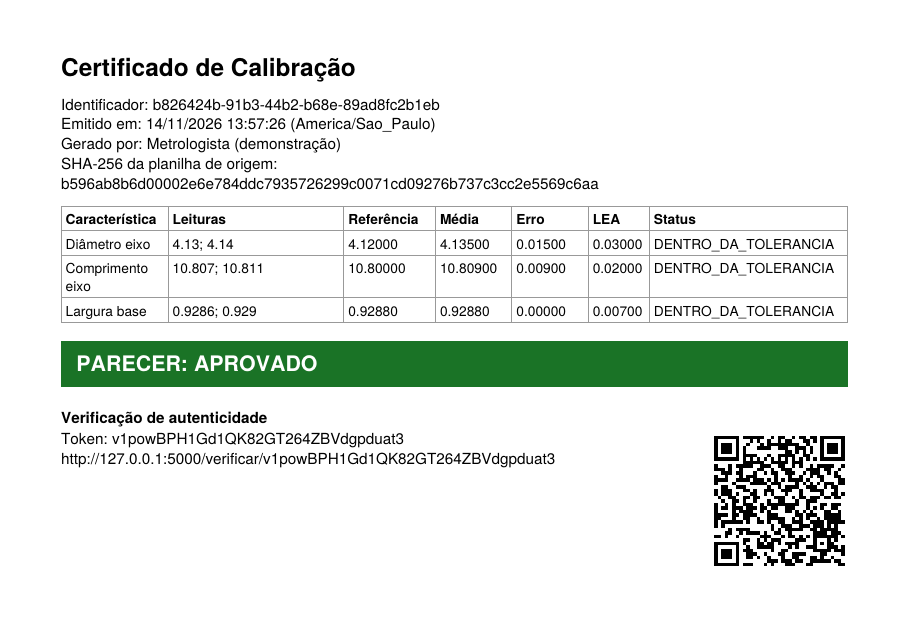
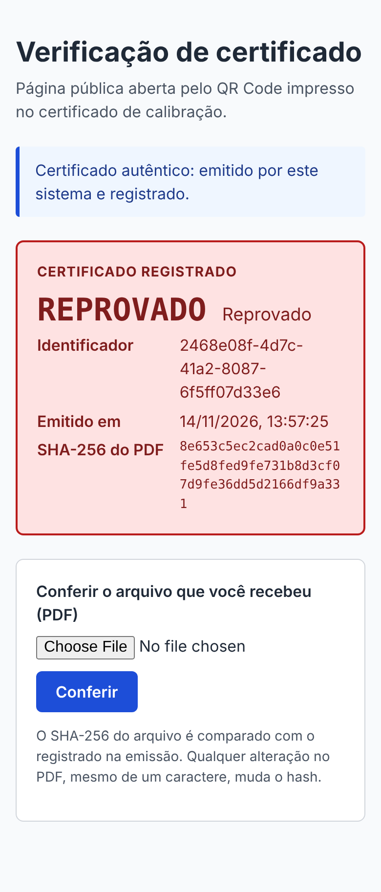
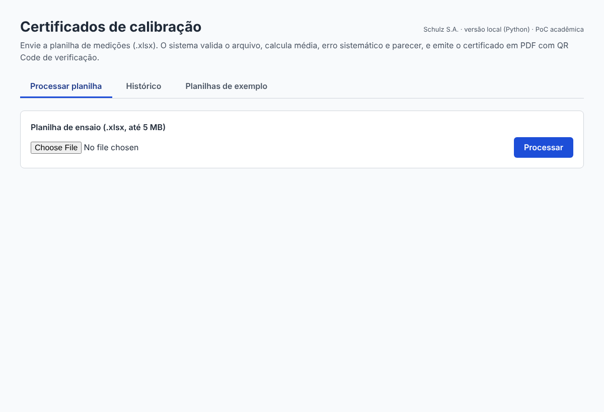
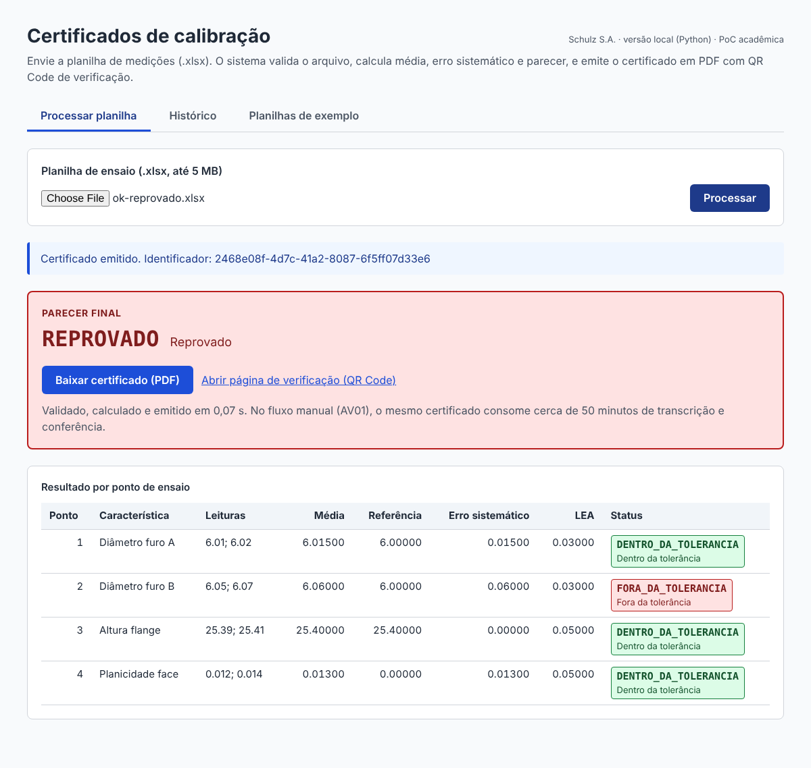
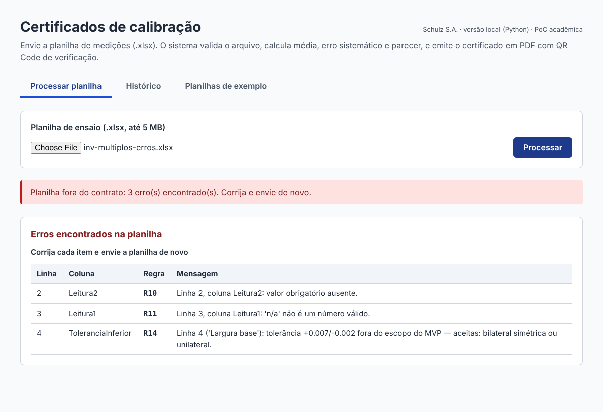
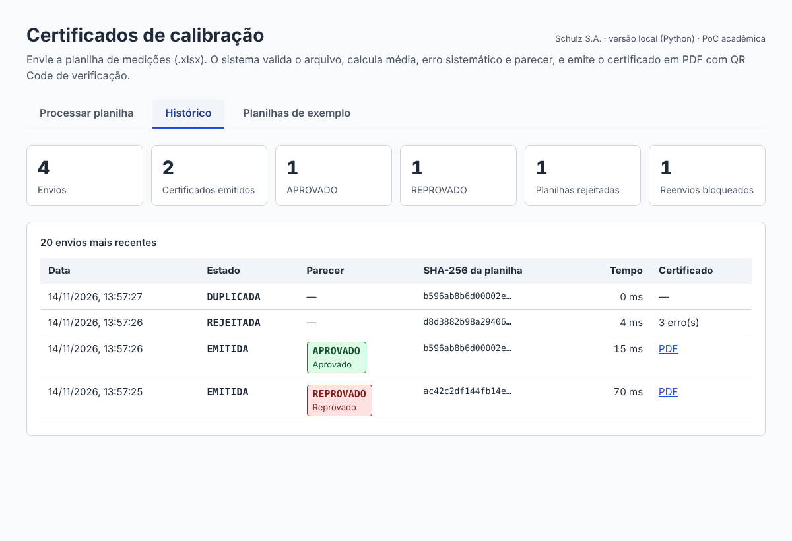

# AV05 — Documentação Técnica do MVP e Estudo de ROI

<!-- PDF: cd ferramentas/relatorio && npm ci && node gerar-relatorio.mjs av05
     As tabelas do ROI (roi.md) e da equivalência (equivalencia.md) são geradas por scripts:
       python ferramentas/roi.py > docs/av05/roi.md
       python ferramentas/equivalencia_java_python.py  (cabeçalho + saída em docs/av05/equivalencia.md) -->

**Relatório Executivo Técnico e Econômico** · Automação da emissão de certificados de calibração (Schulz S.A.)

| | |
| --- | --- |
| **Unidade Curricular** | Projeto Aplicado III — UniSENAI/SC — 2026.2 |
| **Docente** | Prof. MSc. Hugo Menezes Barra |
| **Empresa parceira** | Schulz S.A. — Schulz Metrologia (Setor Dimensional), Joinville/SC |
| **Grupo 39** | Nícolas Kretzschmar Lange — RA `<preencher>`; Rodrigo Mainardes Ribeiro — RA `<preencher>` |
| **Entrega** | AV05 — Documentação técnica do MVP, estudo de ROI e executável `iniciar_aplicacao_schulz.bat` |
| **Repositório GitHub (público)** | <https://github.com/rmainardes/projeto-aplicado-iii> |
| **Executável** | `iniciar_aplicacao_schulz.bat`, `requirements.txt` e `app.py` na raiz do repositório |
| **Plataforma em nuvem (AV04)** | <https://n0jdkil21h.execute-api.us-east-2.amazonaws.com/> (stack `pa3-av04`, `us-east-2`) |
| **Data** | 19/11/2026 |

## 1. Consolidação das entregas

A Schulz Metrologia leva cerca de 13 dias entre medir um dispositivo na máquina de medição por coordenadas
(MMC) e emitir o certificado de calibração. O caminho é uma cadeia de planilhas Excel acopladas por cópia
manual: 28 valores transportados à mão por certificado, cálculo não validado, nenhuma trilha de auditoria.
Cada entrega atacou uma parte desse problema:

| Entrega | Resultado | Onde está |
| --- | --- | --- |
| AV01 — requisitos | Diagnóstico AS-IS (etapas P-01 a P-20), anomalias, requisitos RF/RNF, regras RN, premissas financeiras | relatório da AV01 (fora do Git: cita arquivos reais) |
| AV02 — arquitetura | Pipeline *serverless* na AWS com custo R$ 0,00: upload no storage → função → banco → PDF; retenção de 5 anos | `docs/av02/` |
| AV03 — MVP transacional | Contrato da planilha (R01–R15), motor de cálculo em decimal exato, API e tela; oráculo independente | `nucleo/`, `app-local/`, `docs/av03/` |
| AV04 — plataforma web | Pipeline implantado na AWS, login, histórico com indicadores, certificado com QR Code e verificação pública | `funcoes/`, `web/`, `infra/`, `docs/av04/` |
| **AV05 — esta entrega** | Documentação técnica, ROI e **executável local** (`.bat` + `app.py`) | `schulz/`, `docs/av05/` |

O roteiro da AV05 pede um executável em lote que prepare um ambiente **Python** e rode a aplicação na
máquina do avaliador, sem nuvem e sem JDK. Por isso a entrega acrescenta uma **versão local em Python**
(pacote `schulz/`), porta fiel do núcleo Java (D-028): mesmas 15 regras de validação com as mesmas
mensagens, mesmo cálculo, mesmo certificado com QR Code e a mesma idempotência por hash. A versão em
nuvem da AV04 continua sendo a de produção. As duas foram comparadas planilha a planilha (§6.2): 21 de
21 resultados idênticos.

## 2. Arquitetura da versão local

```
 Navegador (index.html, app.js)           Celular (QR Code → /verificar/<token>)
        │  POST /api/calibracoes/processamento        │  GET /api/verificacao/<token>
        ▼                                              ▼
 app.py ── schulz/web.py (Flask: rotas, problem+json, cabeçalhos de segurança)
                 │
                 ▼
          schulz/servico.py ── SHA-256 → duplicada? ── sim → DUPLICADA (RN-20)
                 │ não
                 ▼
          schulz/ingestao.py + higienizacao.py ── fora do contrato → REJEITADA (erros R01–R15)
                 │ pontos válidos
                 ▼
          schulz/calculo.py (média, erro, status, parecer — Decimal)
                 │
                 ▼
          schulz/certificado.py (PDF + QR Code) ──► dados/certificados/<id>.pdf
                 │
                 ▼
          schulz/repositorio.py (SQLite: dados/calibracoes.db) ── EMITIDA
```

| Módulo | Responsabilidade | Equivalente na nuvem (AV04) |
| --- | --- | --- |
| `ingestao.py`, `higienizacao.py` | Ler e validar o `.xlsx` (R01–R15), higienizar texto e nulos | `LeitorPlanilhaPoi` na `fn-ingestao` |
| `calculo.py` | Média, erro sistemático, status por ponto, parecer | `CalculadoraMetrologica`, `ResultadoPonto` |
| `certificado.py` | PDF com tabela, parecer e QR Code | `GeradorCertificado` na `fn-certificado` |
| `repositorio.py` | Estados, idempotência, token, retenção | DynamoDB `calibracoes` (D-021) |
| `servico.py` | Orquestra ingestão → cálculo → emissão numa chamada | encadeamento `fn-ingestao` → `fn-certificado` |
| `web.py` + `estatico/` | API REST, interface, verificação pública | `fn-api`, SPA React, `fn-web` |

Bibliotecas externas, todas com faixa de versão no `requirements.txt` (D-028): **Flask** (HTTP),
**openpyxl** (leitura do `.xlsx`), **fpdf2** (PDF) e **segno** (QR Code). Banco, hash, decimal e log são
da biblioteca padrão.

## 3. Módulo de Ingestão de Dados

### 3.1 Rotina de leitura do `.xlsx`

A função `ingestao.ler(conteudo)` recebe os bytes do arquivo e devolve a lista de pontos de ensaio, ou
lança `PlanilhaInvalida` com **todos** os erros encontrados. O processamento tem três camadas; as duas
primeiras param no primeiro erro (sem a aba ou o cabeçalho não há o que ler), a terceira coleta tudo:

1. **Arquivo.** Tamanho até 5 MB (R01). Formato verificado pelo conteúdo, não pela extensão: o arquivo tem
   de começar com a assinatura do zip (`PK\x03\x04`) e conter `[Content_Types].xml` e `_rels/.rels`
   (R02). Pacote OOXML *Strict* é recusado com mensagem própria (R03). Proteção contra *zip bomb*: cada
   entrada descompactada limitada a 50 MB e taxa de compressão até 100× (D-013); acima disso, R02.
2. **Estrutura.** O `openpyxl` abre a pasta em modo somente leitura (linha a linha, sem carregar fórmulas
   calculadas). Aba `Medicoes` obrigatória (R04); cabeçalhos `Caracteristica`, `ValorReferencia`,
   `ToleranciaSuperior` e `ToleranciaInferior` (R05); pelo menos duas colunas `Leitura<n>` (R06); coluna
   `Desvio` proibida, porque valor calculado não entra na entrada (R07).
3. **Linhas.** Cada linha passa pela higienização (§3.2) e pelas regras R10–R15; linhas vazias são
   puladas; nenhuma linha válida é R08 e mais de 10 mil linhas, R09.

| Regra | Rejeita | Mensagem ao operador (resumo) |
| --- | --- | --- |
| R01 | Arquivo acima de 5 MB | O arquivo excede o limite de 5 MB. |
| R02 | Não é `.xlsx` (inclui vazio, corrompido, *zip bomb*) | Salve como "Pasta de Trabalho do Excel (.xlsx)". |
| R03 | `.xlsx` Strict | O arquivo está em formato OOXML Strict. |
| R04–R07 | Aba, cabeçalhos, leituras, coluna Desvio | A planilha não contém a aba Medicoes / o cabeçalho X… |
| R08 / R09 | Nenhuma linha / mais de 10 mil linhas | A planilha não contém dados / excede o limite. |
| R10 | Célula obrigatória vazia (nulo) | Linha n, coluna X: valor obrigatório ausente. |
| R11 | Texto, booleano, erro, data ou **fórmula** em coluna numérica | 'abc' não é um número válido / contém fórmula. |
| R12 | Característica repetida | Característica 'X' repetida nas linhas n1 e n2. |
| R13 | Tolerância superior ≤ 0 | A tolerância superior precisa ser maior que zero. |
| R14 | Tolerância nem simétrica nem unilateral | tolerância +a/b fora do escopo do MVP. |
| R15 | Leitura negativa em característica unilateral | leitura negativa — verifique a medição. |

O contrato completo, com a ordem de coleta dos erros, está em `docs/av03/contrato-planilha.md`.

### 3.2 Higienização, caracteres especiais e valores nulos

A higienização (`higienizacao.py`) separa o que pode ser limpo com segurança do que precisa ser recusado:

- **Texto** (nome da característica e cabeçalhos): normalização Unicode NFC (o "â" composto e o
  decomposto viram o mesmo caractere); remoção de caracteres de controle e de formatação invisíveis
  (*zero-width space*, BOM, marcas de direção), que aparecem ao copiar do relatório da MMC ou de e-mail;
  espaços especiais (NBSP, espaço fino, tabulação) viram espaço comum; espaços repetidos colapsam; bordas
  aparadas. Efeito prático: `"Diâmetro␣␣eixo​"` e `"Diâmetro eixo"` são a mesma característica, e a
  repetição disfarçada cai na R12.
- **Nulos:** célula ausente, vazia, só com espaços ou só com caracteres invisíveis é tratada como nula. Em
  coluna obrigatória vira R10, com linha e coluna; linha inteira nula é pulada (sobra de formatação do
  Excel) e não conta no limite de 10 mil.
- **Números não são "consertados".** Texto que parece número (`"10,03"`) é R11, sem conversão: o separador
  decimal é ambíguo (`"1.003"` pode ser 1,003 ou 1003) e corrigir em silêncio esconderia erro de digitação.
  Fórmula é R11 mesmo com valor em cache. O número digitado é lido pelo decimal mais curto que representa o
  valor gravado pelo Excel: 4,14 vira `4.14`, e não `4.1399999999999997`.

A planilha é aceita inteira ou rejeitada inteira: não existe ponto descartado em silêncio. Por LGPD, o nome
do arquivo enviado nunca é lido nem gravado; o log registra só id, SHA-256, tamanho e resultado.

## 4. Motor de Cálculos Metrológicos

Para cada ponto de ensaio com *n* leituras *L₁…Lₙ*, valor de referência *VR* e tolerâncias *Tol+* e *Tol−*:

| Grandeza | Equação | Regra numérica |
| --- | --- | --- |
| Média das leituras | x̄ = (L₁ + L₂ + … + Lₙ) / n | 10 casas decimais, arredondamento `HALF_EVEN` (sem viés; ABNT NBR 5891) |
| Erro sistemático | E = x̄ − VR | subtração exata, com sinal |
| Limite de Erro Admissível | LEA = Tol+ | vale para tolerância bilateral simétrica (Tol− = −Tol+) e unilateral (Tol− = 0) |
| Status do ponto | \|E\| ≤ LEA → `DENTRO_DA_TOLERANCIA`; senão `FORA_DA_TOLERANCIA` | a fronteira (\|E\| = LEA) é dentro |
| Parecer | todos os pontos dentro → `APROVADO`; algum fora → `REPROVADO` | calibração sem pontos não aprova |

**Regras formais de comparação contra o LEA.** (1) Todo valor é `decimal.Decimal` desde a leitura da
célula: nada passa por ponto flutuante binário. Em `double`, 10,07 + 10,09 dá 20,159999999999997, e um
erro exatamente igual ao LEA poderia virar "fora". (2) A comparação usa o valor completo, **sem arredondar
antes**: arredondar a média para 4 casas aprovaria o cenário `ok-arredondamento`, em que \|E\| = 0,00045 e
LEA = 0,0004. (3) Cinco casas decimais só na exibição (tela e PDF). (4) Os enums aparecem literalmente no
código, na API, na tela e no certificado.

Exemplos tirados das planilhas sintéticas (valores conferidos com o oráculo independente da AV03):

| Cenário | Leituras | VR | x̄ | E | LEA | Status |
| --- | --- | --- | --- | --- | --- | --- |
| `ok-reprovado`, Diâmetro furo B | 6,05; 6,07 | 6 | 6,06 | 0,06 | 0,03 | FORA |
| `ok-limite`, Diâmetro bucha | 1,94; 1,96 | 2 | 1,95 | −0,05 | 0,05 | DENTRO (fronteira) |
| `ok-arredondamento`, pino guia | 0,0604; 0,0605 | 0,06 | 0,06045 | 0,00045 | 0,0004 | FORA |
| `ok-tres-leituras`, Diâmetro haste | 1; 1; 1,01 | 1 | 1,0033333333 | 0,0033333333 | 0,003 | FORA |

## 5. Módulo de Emissão e Rastreabilidade

### 5.1 Classificação e estados

O serviço (`servico.py`) aplica a classificação na ordem abaixo; cada envio vira um registro com um estado:

1. Calcula o **SHA-256** e o tamanho do arquivo. Se o mesmo hash já foi registrado, encerra como
   `DUPLICADA`, com ponteiro para o envio original, **sem abrir o Excel** (RN-20): o mesmo arquivo nunca gera
   dois certificados. Um índice único no banco garante isso também com dois envios simultâneos.
2. Planilha fora do contrato → `REJEITADA`, com a lista de erros (linha, coluna, regra, mensagem).
3. Planilha válida → cálculo → parecer `APROVADO` ou `REPROVADO` → PDF → `EMITIDA`. Reprovação é resultado,
   não erro: o certificado é emitido também para `REPROVADO`.

### 5.2 Geração automatizada do certificado em PDF

`certificado.py` desenha o mesmo layout da `fn-certificado` (Figura 1): identificador (UUID), data e hora de
emissão em America/Sao_Paulo, **"Gerado por"** (autoria por autenticação de usuário, sem ICP-Brasil, D-003:
na versão local, o usuário logado no Windows; na nuvem, o Cognito), SHA-256 da planilha de origem, tabela
por ponto (leituras como lidas; referência, média, erro e LEA com 5 casas; status), faixa do parecer
(verde ou vermelho, com o texto escrito, legível também em preto e branco) e o bloco de verificação.



*Figura 1 — Certificado `APROVADO` emitido pela versão local (planilha `ok-aprovado.xlsx`), com o QR Code de verificação.*

### 5.3 QR Code e validação pelo celular

Na emissão, o sistema sorteia um **token** de 32 caracteres (`secrets`, gerador criptográfico; 62³² combinações)
e grava junto o SHA-256 do PDF. O QR Code (nível de correção M, desenhado como vetor no PDF) contém a URL
`<base>/verificar/<token>`. Lido pela câmera do celular, abre uma página pública, sem login, que mostra só o
identificador, a data, o parecer e o hash do PDF: nada de nome de usuário, planilha ou medições. Na mesma
página, quem recebeu o certificado pode enviar o PDF que tem em mãos: o hash é comparado com o registrado e
qualquer alteração, mesmo de um byte, aparece como "NÃO confere". A leitura do QR do certificado gerado foi
decodificada por software e devolveu a URL esperada.

Para o celular alcançar a versão local, a aplicação é iniciada com `--lan` (§7.5): o QR passa a usar o IP do
computador na rede. Sem isso, ela só escuta em `127.0.0.1` e não fica exposta na rede. Na nuvem (AV04), o QR
aponta para o endereço HTTPS público da plataforma.



*Figura 2 — Página de verificação aberta pelo QR Code, em tela de celular.*

### 5.4 Rastreabilidade e retenção

O banco local (`dados/calibracoes.db`, SQLite) guarda por envio: id, data, SHA-256 e tamanho da planilha,
estado, parecer, resultado calculado (valores como texto, preservando a escala), erros, token, SHA-256 do PDF,
ponteiro de duplicata, tempo de processamento e a data até a qual o registro deve ser retido (5 anos, ISO/IEC
17025, D-004). O PDF fica em `dados/certificados/<id>.pdf`. Assim, de um certificado chega-se à planilha de
origem (pelo hash), ao cálculo e a quem o emitiu, e um PDF adulterado é detectado. Não há rota de exclusão.

## 6. Qualidade e evidências

### 6.1 Testes automatizados

`python -m unittest discover -s schulz/testes -t .` roda **33 testes** em cerca de 2 s: o oráculo das 7
planilhas válidas (média e erro na 10ª casa, status e parecer), as 14 inválidas (regra, linha e coluna de cada
erro), R01, R02 (vazio, texto, zip cortado, zip sem pacote OOXML, *zip bomb*), R09 com 10 001 linhas e o
limite de 10 000 aceito, fórmula, booleano e número digitado como texto, higienização (NBSP, *zero-width*,
BOM, nulos) e a API de ponta a ponta (emissão, download do PDF com o hash conferido, duplicata, rejeição com
400 `problem+json`, 413, 415, 404, conferência de PDF adulterado, ausência de nome de arquivo e de usuário no
log e no banco). Rodaram verdes em Python 3.10 e 3.13 no Linux e em CPython 3.10 para Windows. A suíte Java
da AV04 (154 testes) continua no repositório.

### 6.2 Equivalência com a implementação Java

`ferramentas/equivalencia_java_python.py` compara o resultado da versão local com as respostas reais da API
Java gravadas na AV03 (`docs/av03/evidencias/respostas/`), campo a campo; nos erros, até o texto da mensagem.

<!-- incluir: equivalencia.md -->

### 6.3 Execução do `.bat` e desempenho

O script foi executado no interpretador de comandos do Windows (`cmd.exe` do Wine 9.0) com o CPython 3.10
oficial para Windows, a partir de uma pasta com espaços no nome: sem Python no PATH, mostra o erro e para;
com Python, cria o `.venv`, instala as bibliotecas, sobe a API numa janela própria e abre o navegador. A
transcrição está em `docs/av05/evidencias/execucao-bat.txt`. As rodas (*wheels*) para Windows de todas as
dependências foram conferidas para Python 3.10 a 3.14.

Desempenho medido (Linux, Python 3.13): validação + cálculo + PDF de uma planilha sintética em **12 ms**
(mediana de 140 execuções; máximo de 66 ms); a planilha máxima do contrato (10 mil linhas) é lida e calculada
em 0,5 s. Pela interface, o tempo exibido inclui hash, banco e PDF (15 a 70 ms).

## 7. Manual de instalação e uso

### 7.1 Requisitos

- Windows 10 ou 11 (Linux e macOS: `iniciar_aplicacao_schulz.sh`, mesmos passos).
- **Python 3.10 ou superior** no PATH. Se não tiver: <https://www.python.org/downloads/>, e no instalador
  marque **"Add python.exe to PATH"**.
- Internet na primeira execução (download das bibliotecas, cerca de 15 MB). Depois funciona offline.
- Não precisa de JDK, banco de dados, conta AWS nem permissão de administrador.

### 7.2 Instalar e iniciar

1. Baixe o repositório: no GitHub, **Code → Download ZIP** e extraia; ou
   `git clone https://github.com/rmainardes/projeto-aplicado-iii`.
2. Na pasta extraída, dê dois cliques em **`iniciar_aplicacao_schulz.bat`**.
3. O script executa quatro passos e mostra o progresso:

| Passo | O que o `.bat` faz | Se der errado |
| --- | --- | --- |
| 1/4 | Procura `python`, `python3` ou o lançador `py -3` no PATH e exige versão 3.10+ (ignora o atalho da Microsoft Store) | Mensagem com o link de instalação; o script para |
| 2/4 | Cria o ambiente virtual `.venv` (só na primeira vez) e o ativa | Apague a pasta `.venv` e rode de novo |
| 3/4 | Instala os pacotes do `requirements.txt`; nas execuções seguintes, só reinstala se o arquivo mudar | Verifique internet ou proxy |
| 4/4 | Abre a API (`app.py`) numa janela própria, espera ela responder em `/api/saude` e abre `http://127.0.0.1:5000/` no navegador padrão | Porta ocupada: `set SCHULZ_PORTA=5050` e rode de novo |

4. Para encerrar, feche a janela **"Schulz - API"**. Para usar de novo, rode o `.bat` outra vez (os
   passos 2 e 3 são pulados e a aplicação abre em poucos segundos).



*Figura 3 — Interface aberta pelo `.bat`.*

### 7.3 Inserir a planilha

1. Para testar sem dados da empresa, abra a aba **Planilhas de exemplo** e baixe, por exemplo,
   `ok-reprovado.xlsx` (as `ok-*` passam no contrato; as `inv-*` violam uma regra cada).
2. Na aba **Processar planilha**, clique em **Escolher arquivo**, selecione o `.xlsx` e clique em
   **Processar**.
3. Para uma planilha real: aba `Medicoes`, colunas `Caracteristica`, `ValorReferencia`, `Leitura1`,
   `Leitura2`… (no mínimo duas), `ToleranciaSuperior` e `ToleranciaInferior`, valores digitados como número,
   sem fórmulas, salvo como "Pasta de Trabalho do Excel (.xlsx)".

### 7.4 Ler o resultado

- **Parecer final** em destaque (`APROVADO` em verde, `REPROVADO` em vermelho), o tempo de processamento e
  a comparação com o fluxo manual.
- **Tabela por ponto:** leituras, média, referência, erro sistemático, LEA e status (§4).
- **Baixar certificado (PDF)** e **Abrir página de verificação**.
- Planilha fora do contrato: lista de erros com linha, coluna, regra e mensagem; corrija tudo e envie de novo.
- Arquivo já enviado: aviso de duplicata e o resultado original, sem novo certificado.
- Aba **Histórico:** indicadores (envios, emitidos, aprovados, reprovados, rejeitadas, reenvios bloqueados) e
  os 20 envios mais recentes, com o PDF de cada certificado.



*Figura 4 — Planilha `ok-reprovado.xlsx`: um ponto fora da tolerância reprova o dispositivo.*



*Figura 5 — Planilha `inv-multiplos-erros.xlsx`: os três erros aparecem juntos, com linha, coluna e regra.*



*Figura 6 — Histórico com indicadores; o reenvio da mesma planilha foi bloqueado (`DUPLICADA`).*

### 7.5 Conferir pelo celular (opcional)

Inicie com `iniciar_aplicacao_schulz.bat --lan`. O Windows pode pedir para liberar o Python no firewall
(aceite só em rede privada). Emita um certificado, abra o PDF na tela e aponte a câmera do celular, conectado
ao mesmo Wi-Fi, para o QR Code. Fora desse teste, use o modo padrão, que não aceita conexões da rede.

### 7.6 Configurações e arquivos

| Item | Padrão | Como mudar |
| --- | --- | --- |
| Porta | 5000 | variável `SCHULZ_PORTA` |
| Pasta de dados (banco, PDFs, log) | `dados\` | variável `SCHULZ_DADOS` |
| Nome em "Gerado por" | usuário do Windows | variável `SCHULZ_OPERADOR` |
| Testes automatizados | — | `.venv\Scripts\python -m unittest discover -s schulz/testes -t .` |

### 7.7 Ganhos em relação à execução manual

| Aspecto | Fluxo manual (AV01) | Com o software |
| --- | --- | --- |
| Transporte dos 28 valores e conferência visual | 20 min, sujeito a erro de transposição | leitura automática; 15 regras validadas em milissegundos |
| Cálculo | fórmulas de planilha editável, não validadas | motor único, testado contra oráculo independente, decimal exato |
| Parecer | célula de status, interpretação do leitor | regra formal \|E\| ≤ LEA, enums explícitos |
| Emissão do PDF | exportação manual, página em branco (AN-24) | automática, layout fixo, com hash e QR Code |
| Rastreabilidade | arquivos em pasta pessoal | registro com hash da planilha e do PDF, retenção de 5 anos |
| Autenticidade para o cliente | nenhuma | verificação pública pelo QR Code |
| Ciclo do certificado (P-06 a P-18) | **53 min** | **17 min** (−68%), §8 |

## 8. Estudo de Retorno sobre o Investimento (ROI)

As contas abaixo saem de `ferramentas/roi.py` (decimal exato, só biblioteca padrão): trocar uma premissa e
rodar de novo atualiza todas as tabelas. Todas as premissas marcadas `[PREMISSA]` vêm da AV01 e precisam ser
confirmadas pela Schulz antes de uso gerencial (D-029).

<!-- incluir: roi.md -->

### Ganhos não monetizados

A conta acima considera só horas e retrabalho. Ficam fora, por não haver dado da empresa para valorá-los
sem inventar números: (1) o **lead time** de 13 dias entre medição e certificado, que hoje deixa o
dispositivo parado ou em uso sem certificado vigente; com a emissão no mesmo dia da medição, o gargalo passa
a ser só a assinatura; (2) o **risco em auditoria** (ISO 9001, IATF 16949, requisitos inspirados na ISO/IEC
17025): cálculo não validado, certificados com placeholder e assinatura sem vínculo ao dado, achados que a
AV01 apontou e que o software elimina; (3) a **escala**: outras famílias de instrumentos entram sem custo
marginal de infraestrutura; (4) **82 horas técnicas por ano** liberadas, cerca de 10 dias de trabalho de um
metrologista, que voltam para medição.

### Parecer Executivo de Viabilidade Financeira

**A automação é financeiramente viável e recomenda-se a implantação.** Para a Schulz, o desembolso efetivo é
de R$ 1.950,00 (validação do software e implantação), porque o desenvolvimento foi feito na parceria
acadêmica; com a economia líquida de R$ 5.814,15 por ano no cenário base, o investimento se paga em **4 meses**
e o ROI em 12 meses é de **198%**, sem custo de infraestrutura (Free Tier na nuvem; computador existente na
versão local).

Na visão econômica completa, como se o desenvolvimento tivesse sido contratado (R$ 12.750,00), o payback é de
**26 meses**, o ROI em 12 meses é negativo (−54%) e passa a **37% em 36 meses** e 128% em 60 meses, o prazo de
retenção dos registros. O projeto se paga dentro do ciclo de vida, mas não no primeiro ano: com o volume
atual, a justificativa econômica pura depende também dos ganhos não monetizados acima. Com 268
certificados/ano (por exemplo, incluindo outras famílias de instrumentos), o payback cai para 12 meses mesmo
nessa visão. No cenário conservador (100 certificados/ano, R$ 60,00/h, menos ganho de tempo), a visão
econômica não se paga em 36 meses, mas o desembolso efetivo ainda retorna em cerca de um ano.

Recomendações: (1) implantar a versão local já, com custo de infraestrutura zero, e validar o software com
o laboratório (ISO/IEC 17025 §7.11.2); (2) medir por um mês o tempo real por certificado e o volume, e rodar
`ferramentas/roi.py` com esses dados; (3) estender o contrato da planilha a outras famílias de instrumentos,
que é o que mais move o ROI; (4) evoluir para a plataforma em nuvem quando houver mais de um laboratório ou
acesso externo, com a região `sa-east-1` e assinatura do signatário (§9).

## 9. Limitações e próximos passos

- **Duas implementações do núcleo** (Java na nuvem, Python local): toda mudança de regra vale para as duas, e
  a equivalência (§6.2) precisa rodar a cada mudança. A higienização da §3.2 ainda não foi levada ao Java.
- **Fora do escopo do MVP**, mantidos no roadmap da AV04: aprovação do signatário (RN-12), incerteza de medição
  (k, veff), padrão e condições ambientais no certificado, integração com o LightLab, numeração sequencial e
  imutabilidade garantida (Object Lock).
- **Versão local:** servidor de desenvolvimento do Flask, adequado a um posto de trabalho; uso por vários
  usuários exige servidor WSGI e autenticação própria (ou a versão em nuvem). A autoria vem do login do
  Windows, sem senha própria do sistema.
- **Premissas do ROI** a confirmar com a Schulz: volume anual, custo-hora, tempos por etapa, taxa de retrabalho.
- **Plano gratuito da AWS:** os créditos da conta valem até 24/04/2027; depois, Lambda, DynamoDB, Cognito e SQS
  seguem nas cotas permanentes, e S3 e API Gateway passam a custar centavos por mês no volume da PoC.

## Referências

- Roteiro de instruções de entrega — AV05, Projeto Aplicado III, Prof. MSc. Hugo Menezes Barra, 2026.
- Relatórios das entregas AV01 a AV04 do Grupo 39 e registro de decisões `docs/decisoes.md` (D-001 a D-029).
- ABNT NBR ISO/IEC 17025:2017 — Requisitos gerais para a competência de laboratórios de ensaio e calibração (§7.11, controle de dados e gestão da informação).
- ABNT NBR 5891 — Regras de arredondamento na numeração decimal.
- Python Software Foundation — `decimal`, `sqlite3`, `hashlib`, `secrets`: <https://docs.python.org/3/library/>.
- Flask 3.1, openpyxl 3.1, fpdf2 2.8, segno 1.6 — documentação oficial no PyPI: <https://pypi.org/>.
